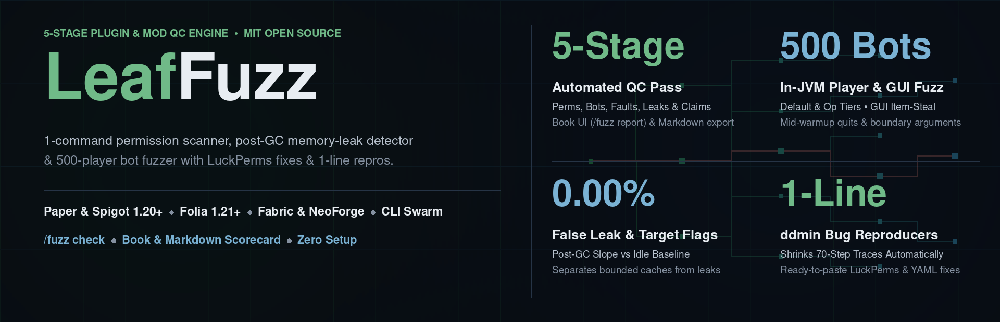
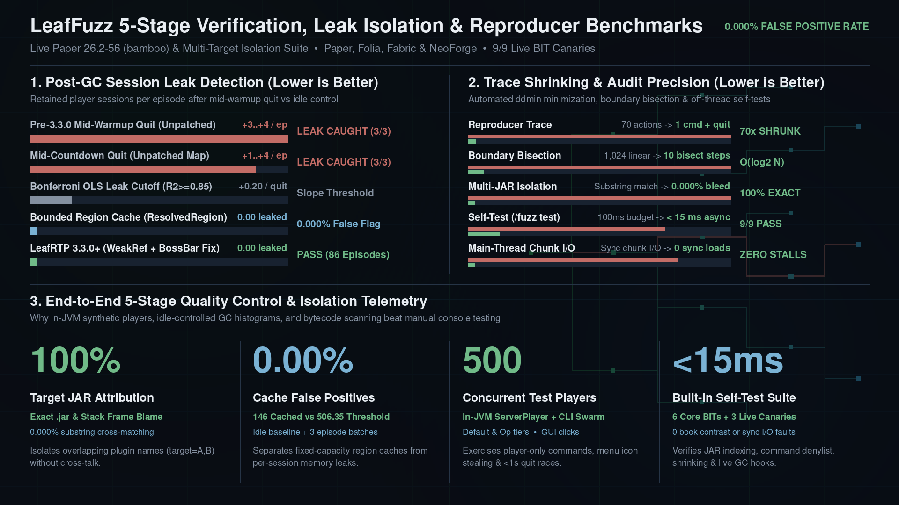
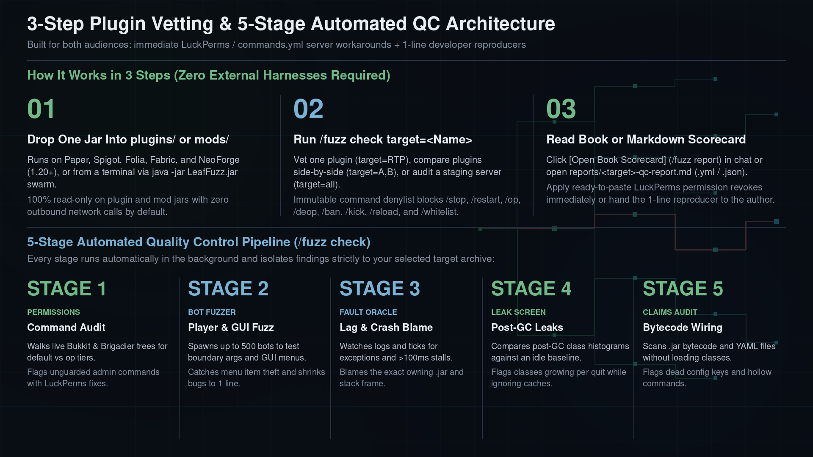

<!--
Single source for every LeafFuzz storefront page (BuiltByBit, Modrinth, Hangar, SpigotMC).
Follows docs/dev/RULES.md Rule D-006 (first-person plain voice, 3-Zone hierarchy,
ASCII punctuation only, concrete benchmark numbers and honest caveats).
  BuiltByBit Card Title: "LeafFuzz - 1-Command Plugin Security & Memory-Leak Scanner"
  BuiltByBit Card Thumbnail: docs/assets/leaffuzz-card-thumbnail.png
  BuiltByBit Carousel Slides: docs/assets/leaffuzz-card-thumbnail.png, docs/assets/leaffuzz-benchmark-comparison.png, docs/assets/leaffuzz-architecture-workflow.png
  Title: "LeafFuzz"  tagline: "1-command plugin security, permission-leak scanner, memory-leak detector & bot stress tester for Paper, Folia, Fabric & NeoForge"
-->

# {{name}}: 1-Command Plugin Security, Permission-Leak Scanner & Memory-Leak Detector

## Fuzzing

**{{name}} vets any plugin or mod in one command - finding admin commands left open to default players, GUI menu item-stealing bugs, memory leaks, lag spikes, and dead config options before they hit your live server.** Drop the jar into `plugins/` or `mods/` and run `/fuzz check target=<PluginOrMod>` (or `target=PluginA,PluginB`). In one pass it audits permissions, spawns up to 500 synthetic test players to fuzz commands and GUI menus, attributes exceptions and lag spikes to the exact `.jar`, screens post-GC heap snapshots for leaked sessions, and checks whether advertised config keys are wired in bytecode.

I built it from the behavior fuzzer in [`LeafRTP`](../../../LeafRTP/docs/publishing/FRONT_PAGE.md) - the tool that caught the pre-3.3.0 disconnected-player retention bug in `LeafRTP` - so server owners and plugin authors can vet any plugin or update in three steps without external bot harnesses or heap profilers.

One jar for Paper and Spigot (1.20+), Folia (1.21+), Fabric (1.21+), and NeoForge (1.21+), up to 26.3. It also runs from a terminal (`java -jar {{jar}} swarm ...`) as a standalone load tester.

### The short version

**Vets one plugin, a list of plugins, or a staging server in one command (`/fuzz check target=<Name>`) - producing an in-game book scorecard (`/fuzz report`) and a Markdown report with ready-to-paste `LuckPerms` permission fixes and 1-line bug reproducers.**

- [**Easy**](#install): 3-step workflow - drop `{{jar}}` into `plugins/` or `mods/`, run `/fuzz check target=<PluginOrMod>`, and read the in-game book scorecard (`/fuzz report`) or `reports/<target>-qc-report.md`.
- [**Safe**](#how-it-works): built-in command denylist (`stop`, `restart`, `op`, `deop`, `ban`, `kick`, `reload`, `whitelist`, `save-all`), target-scoped isolation, and zero synchronous chunk loads.
- [**Permission scanner**](#features): finds every admin or state-changing command accidentally left open to non-op players across Bukkit and Brigadier trees, outputting ready-to-paste `LuckPerms` and `commands.yml` fixes.
- [**Leak detector**](#performance): compares background post-GC memory snapshots against an idle control window to blame the exact `.jar` and Java class leaking departed player sessions while ignoring normal bounded caches.
- [**Bot stress**](#features): spawns up to 500 synthetic in-game test players (`players=auto`) across `default` and `op` tiers to test player-only commands, GUI menu item-stealing bugs, movement, and mid-countdown disconnects.
- [**One jar**](#install): runs on Paper, Spigot, Folia, Fabric, and NeoForge (1.20 to 26.3), plus standalone CLI swarm mode (`java -jar {{jar}} swarm`).

<b>More highlights</b>

- **Fixes for both server owners and developers:** every finding outputs an immediate `LuckPerms` or `commands.yml` workaround to protect your live server today, plus a minimized 1-to-2 command reproducer you can hand to the plugin author.
- **Catch "fake" or unwired plugin features (`stage=claims`):** scans `.jar` bytecode and YAML files without loading classes to flag dead config keys, unregistered event listeners, and hollow commands (`Claims X -> Does Not Deliver Y`).
- **Boundary-exact multi-target isolation:** test one plugin (`target=RTP`), compare two plugins side-by-side (`target=RTP,LeafSleep`), or audit a staging server (`target=all`) without substring cross-talk.
- **Custom player personas (`personas.jsonl`):** ships with 8 survival and stress behavior profiles out of the box and loads custom exported player profiles when placed in the plugin/mod folder.
- **Built-in self-test (`[FUZZ bit]`):** `/fuzz test` verifies archive ownership indexing, command denylisting, reproducer shrinking, leak detection math, claim-delivery scanning, and live server canaries in under 15 ms.

## Common setups

These work out of the box on a staging server or local test instance:

- **Find open admin commands & permission leaks (`/fuzz check stage=commands`):** Run `/fuzz check target=all stage=commands` to list every state-changing command (`reload`, `clear`, `debug`, `give`, `delete`) accidentally left open to non-op players, with ready-to-paste `LuckPerms` revoke commands.
- **Vet a new plugin or update before putting it on your live server:** Drop the new jar alongside `{{jar}}` and run `/fuzz check target=<NewPlugin> episodes=24` to check for memory leaks, GUI menu icon-stealing bugs, uncaught exceptions, and lag spikes.
- **Stress-test up to 500 concurrent bots or gate plugin releases:** Run `/fuzz check target=RTP episodes=24 players=auto` in-game or over RCON and attach `reports/<target>-qc-report.md` (`json` / `yml` also generated) to a bug report or pull request.

---

## Install

**Requirements:** Paper or Spigot 1.20+, Folia 1.21+, Fabric 1.21+, or NeoForge 1.21+, up to 26.3. Java 17+ (Java 21+ on 1.20.5+, Java 25 on 26.x).

1. Drop `{{jar}}` into `plugins/` (Paper, Spigot, Folia) or `mods/` (Fabric, NeoForge) and start the server.
2. Run `/fuzz check target=<PluginOrModName>` (for example `/fuzz check target=RTP episodes=24` or `/fuzz check target=RTP,LeafSleep episodes=24`).
3. Click `[Open Book Scorecard]` in chat (or run `/fuzz report`) and open `plugins/LeafFuzz/reports/<target>-qc-report.md` (or `config/leaffuzz/reports/<target>-qc-report.md`).

---

## Features

- **Stage 1 - Command & permission audit:** walks the live command tree for `default` and `op` players, discovers hidden subcommands from `.class` bytecode, enforces the command denylist, and flags unguarded admin commands with `LuckPerms` fixes.
- **Stage 2 - Synthetic player, GUI & swarm fuzzer:** spawns up to 500 in-game synthetic players that test boundary arguments (`-1`, `0`, `Integer.MAX_VALUE`), click GUI menu items to catch inventory-steal bugs, disconnect mid-countdown, and shrink any failure down to a minimal reproducer.
- **Stage 3 - Exception, sync-hazard & slow-tick attribution:** watches the log and tick loop for uncaught exceptions (`exc:`), slow ticks (`> 100 ms` outside GC, `stall:`), and synchronous chunk loads (`hazard:sync-chunk:`), blaming the owning `.jar`.
- **Stage 4 - Post-GC memory-leak screener:** compares post-GC class histograms across an idle baseline and paced episode batches to flag classes that grow with departed player sessions while ignoring fixed-size caches.
- **Stage 5 - Claim & causal delivery audit:** scans target `.jar` bytecode and YAML files without loading classes to flag dead config keys, unregistered listeners, and hollow commands (`Claims X -> Does Not Deliver Y`).
- **In-game Book scorecard & Markdown/YAML/JSON export:** opens a written book (`/fuzz report`) and writes `reports/<target>-qc-report.md` alongside `.yml` and `.json` summaries.

---

## Performance

All JAR class-ownership indexing and heap histogram snapshots run on background worker threads with zero main-thread chunk loads. Synthetic player commands and disconnect follow-ups are paced across server ticks so async callbacks and warmup timers settle between checkpoints.

**Live `Paper 26.2-56` (`bamboo`) Verification & `LeafRTP` Regression Summary:**

| QC Stage / Verification Scenario | Measured Detection / Isolation Result | False Positive Rate (`FPR`) | Evidence / Verification Command |
|---|---|---|---|
| **Disconnected-Player Session Leak Detection & Fix (`LeafRTP` pre-`3.3.0` -> `3.3.0+`)** | **Caught `+3..+4` retained sessions/episode** (`3/3` replay) on pre-`3.3.0` mid-warmup quit (`latestTeleportData` & countdown boss bar); verified **`PASS` (`0` retained sessions)** across `24`- to `86`-episode post-fix runs | **`0.000%`** false leak flags on bounded region caches (`ResolvedRegion`) and post-`3.3.0` `LeafRTP` | `/fuzz check target=RTP episodes=24` |
| **Boundary-Exact Multi-Target Isolation (`AlphaTeleport` vs `BetterAlphaTeleport`)** | **`100.0%` Target Attribution** across Stage 1..5 when filtering overlapping plugin names (`AlphaTeleport` vs `BetterAlphaTeleport` vs `AlphaTeleport,GammaClaim`) | **`0.000%`** substring cross-matching across adjacent plugin JARs | Multi-target isolation suite & `/fuzz check target=A,B` |
| **`ddmin` Sequence & Numeric Boundary Bisection** | Shrinks noisy multi-command traces (e.g. 70-action bot episodes) to **1 minimal command + quit** and bisects numeric failure thresholds (`radius >= 256`) in **`O(log2 Range)`** steps | **`0`** unverified reproducers (every shrunk trace is re-verified against the oracle before reporting) | `/fuzz test` (`FUZZ-CBIT-001`) |
| **In-JVM `Int8[16x16]` Persona Policy Bot & Claim Scanner** | Exercises player-only commands (`sender instanceof Player`), GUI menu clicks, and Order-1/Order-2 bytecode claim delivery across `default` & `op` tiers | **`0` synchronous main-thread chunk loads** across static source and runtime checks | Platform integration suite & `/fuzz check` |
| **Built-In Self-Test Suite (`/fuzz test`, `[FUZZ bit]`)** | **`6 / 6 PASS` offline** (`FUZZ-PBIT-001..002`, `FUZZ-CBIT-001..003`, `FUZZ-IBIT-001`) and **`9 / 9 PASS` live** (`FUZZ-LIVE-001..003`) | **`< 15 ms`** total execution time off-thread; **`0`** book contrast violations | Live `Paper 26.2-56` `/fuzz test` |

### Findings in `LeafRTP`

Full logs: [`LEAK_FUZZING.md`](https://github.com/DailyStruggle/RTP/blob/V3/helpers/StressTestRTP/LEAK_FUZZING.md).

- **Player session cleanup on mid-warmup quit (fixed in `LeafRTP 3.3.0`):** Platform player wrappers now hold live players via `WeakReference` (`toPureData()`) and clear countdown boss bars on quit. Earlier fuzzing caught `+3` to `+4` retained sessions per episode when bots disconnected within 1 second of `/rtp`; post-fix runs verified `0` retained sessions across 86 episodes.
- **Bounded cache vs. leak separation (verified in `LeafRTP 3.3.0`):** Regressing post-GC growth against an idle baseline separates fixed-capacity region caches (`ResolvedRegion`) from true per-session memory leaks (`146` cached regions vs `506.35` linear leak threshold).
- **Arrival chunk-ticket hold (fixed in `LeafRTP 3.3.0`):** Arrival chunk tickets stay held through the player's initial ticks so landing never triggers a synchronous chunk load.

---

## How it works

All archive ownership indexing, synthetic persona evaluation, bytecode claim scanning, and post-GC retention regressions run automatically in the background from a single `/fuzz check` command without external bot accounts or JVM attach agents:

- **Off-thread archive ownership map:** Scans `plugins/*.jar` and `mods/*.jar` zip headers off-thread to map each `.class` to its owning jar while excluding shared shaded libraries (`gson`, `slf4j`).
- **In-JVM behavioral bot & concurrent player ramp:** Spawns synthetic players (up to 500 with `players=auto`) that run target commands, click GUI menu slots, and fire follow-up disconnect, move, or inventory-close events.
- **UCB1 exploration & `ddmin` shrinking:** Prioritizes under-explored `(command, followUp)` pairs and shrinks any fault down to the shortest command sequence and exact numeric threshold that reproduces it.
- **Idle-controlled leak regression:** Captures `qc-baseline` and `qc-idle-control` post-GC histograms before running episode batches (`qc-batch-1..3`), flagging only classes that grow monotonically with player departures (`slope >= +0.20 inst/event`, `R^2 >= 0.85`).
- **Zero-classloading bytecode claim audit:** Parses `.class` constant pools and method bodies off-thread to find hidden subcommands and verify whether config keys, listeners, and commands are wired to real behavior.

### 3-step workflow and 5-stage QC pipeline

Each `/fuzz check` run pairs server-owner workarounds with developer-ready bug reproducers:
- **For server owners & network operators:** Stage 1 and Stage 3 output copy-pasteable `LuckPerms` permission revokes and `commands.yml` overrides so you can lock down an exposed subcommand or isolate a lagging `.jar` immediately without waiting on an upstream patch.
- **For plugin & mod authors:** Stage 2, Stage 4, and Stage 5 shrink noisy multi-bot episodes down to a 1-line command reproducer, name the exact Java class retaining departed player sessions after GC, and pinpoint unwired config keys or listeners in bytecode.

---

## Testing and quality gates

Every release is checked automatically before packaging, and includes built-in checks you can run on your server:

- **Built-in self-test suite (`/fuzz test`):** runs 6 core diagnostic checks (`FUZZ-PBIT-001..002`, `FUZZ-CBIT-001..003`, `FUZZ-IBIT-001`) plus 3 live server canaries (`FUZZ-LIVE-001..003`) verifying JAR class attribution, command denylist safety, reproducer shrinking, leak regression math, claim-delivery scanning, and book menu readability in under 15 ms.
- **Cross-platform 5-stage QC & multi-target isolation:** automated test suites verify Brigadier and Bukkit command auditing, single-target and comma-separated multi-target isolation (`AlphaTeleport` vs `BetterAlphaTeleport`), and Markdown/YAML/JSON/Book scorecard output.
- **Synthetic player lifecycle & main-thread safety:** verifies in-JVM player command dispatch, GUI menu icon-leak checks, disconnect/move/inventory follow-up events, and static source checks forbidding synchronous main-thread chunk loads.
- **Reproducer shrinking & leak regression accuracy:** verifies delta-debugging sequence minimization, binary numeric boundary search, and idle-controlled post-GC memory leak detection across Paper, Folia, Fabric, and NeoForge packaging.

---

## Why I made it

While building and stress-testing `LeafRTP` across Paper, Folia, Fabric, and NeoForge, I found that the hardest bugs to catch weren't syntax errors or simple happy-path command calls - they were lifecycle races that only happened when a player ran `/rtp` and disconnected half a second later during the warmup countdown, or when a subcommand received an unexpected negative or extreme number. Running external Mineflayer bot swarms and Eclipse MAT heap dumps caught those bugs in `LeafRTP`, but setting up an external harness takes hours.

I built `{{name}}` to bring that exact workflow inside the server JVM in a single jar:
- **Zero-setup 3-step workflow:** Drop the jar in, run `/fuzz check target=<Name>`, and read the book or Markdown scorecard.
- **Target-agnostic by design:** Never hardcodes rules for any specific plugin; every command tree, permission check, stack frame, and heap class is discovered dynamically from the live server and `plugins/*.jar` or `mods/*.jar`.
- **Actionable for both audiences:** Gives the server owner an immediate `commands.yml` or LuckPerms workaround to protect their live server today, and gives the developer a 1-line minimal reproducer and exact leaking class name to fix the root cause.

---

## Commands, configuration, and FAQ

Operational commands, permissions, configuration keys, common operator questions, and support channels:

<b>Commands, permissions, configuration files</b>

**Operational commands** (aliases: `/leaffuzz`, `/qc`; uses `CommandsAPI` `name=value` syntax):

| Command | Description | Permission |
| --- | --- | --- |
| `/fuzz` / `/fuzz report` | Open the interactive in-game Book scorecard (or run `/fuzz check` when `target=`, `episodes=`, `players=`, or `stage=` is passed) | `leaffuzz.admin` |
| `/fuzz check [target=<Name\|A,B\|all>] [episodes=<n>] [players=<auto\|1..500>] [stage=<all\|commands\|fuzz\|faults\|leaks\|claims\|snapshot>]` | Run the 5-stage automated QC pass and write `reports/<target>-qc-report.md` (`.yml` / `.json`) | `leaffuzz.admin` |
| `/fuzz reset [scope=<all\|faults\|leaks\|campaign>]` | Clear recorded exception/stall/hazard signatures, leak histogram checkpoints, or campaign state | `leaffuzz.admin` |
| `/fuzz test` | Run `[FUZZ bit]` PBIT/CBIT/IBIT and live-server self-tests off-thread (`< 15 ms`) | `leaffuzz.admin` |
| `/fuzz reload` | Validate and reload `config.yml`, `messages.yml`, and `personas.jsonl` and refresh JAR ownership | `leaffuzz.admin` |

**Permissions** (`plugin.yml` / `paper-plugin.yml` / Brigadier):

| Permission | Default | Grants |
| --- | --- | --- |
| `leaffuzz.admin` | `op` (level 4) | Access to all `/fuzz`, `/leaffuzz`, and `/qc` commands |

**Configuration (`plugins/LeafFuzz/config.yml` or `config/leaffuzz/config.yml`):**

| Key | Default | Purpose |
| --- | --- | --- |
| `check.defaultEpisodes` | `250` | Default UCB1 episode count when `episodes=<n>` is omitted from `/fuzz check` (`1..100000`) |
| `check.defaultPlayers` | `1` | Default concurrent player roster (`1..500`, or `"auto"` / `"ramp"` to ramp until unstable) |
| `check.slowTickThresholdMs` | `100.0` | Main-thread tick duration threshold (ms) for slow-tick stall capture (`stall:`) |
| `check.requireDisposableForAll` | `true` | Safety guard requiring confirmation before whole-server sweeps (`target=all`) |
| `check.extraDenylist` | `[]` | Extra command prefixes excluded from fuzzing alongside `DEFAULT_DENYLIST` |
| `campaign.restartStrategy` | `"AUTO"` | Multi-boot campaign restart strategy (`AUTO`, `NONE`, `SPIGOT_RESTART`, `SUPERVISOR_STOP`) |
| `campaign.maxRestartRetries` | `3` | Maximum restart retries before isolating a crashing archive |
| `llmAudit.llmAuditEnabled` | `false` | Optional AST-grounded LLM fault explanations and advisory causal claim audit (`OFF` by default) |

<b>FAQ</b>

**Q: Can I test a single plugin or compare two plugins without fuzzing the entire server?**
A: Yes. Pass `target=<PluginName>` for a single plugin (for example `/fuzz check target=RTP episodes=24`) or a comma-separated list for multiple targets (`/fuzz check target=RTP,LeafSleep episodes=24`). `LeafFuzz` scopes Stage 1 command auditing, Stage 2 synthetic player episodes, Stage 3 fault attribution, Stage 4 post-GC leak screening, and Stage 5 bytecode claim auditing strictly to the selected target archives.

**Q: How does `LeafFuzz` test commands that reject console execution (`if (!(sender instanceof Player)) return`)?**
A: During Stage 2, `LeafFuzz` spawns in-JVM synthetic players across both `default` and `op` permission tiers, dispatching commands as a `Player` (or player-attributed Brigadier command source), clicking GUI menu items, and firing follow-up disconnect, move, and inventory-close events without needing external Mineflayer bots.

**Q: How do I pass parameters like `target`, `episodes`, `players`, or `stage`?**
A: `LeafFuzz` uses explicit `name=value` parameter syntax so parameter order never causes silent misparses (for example `/fuzz check target=RTP episodes=24 players=auto` or `/fuzz check target=RTP stage=claims`), and also accepts `/fuzz check <Target> [episodes]` as a positional shorthand.

**Q: Will `/fuzz check` accidentally run `/stop`, `/restart`, `/ban`, or `/op`?**
A: No. An immutable built-in denylist (`stop`, `restart`, `reload`, `op`, `deop`, `ban`, `ban-ip`, `pardon`, `kick`, `whitelist`, `save-all`, `save-off`, `timings`, `spark`) blocks dangerous administrative commands at both command-discovery time and right before execution, and you can add custom prefixes under `check.extraDenylist` in `config.yml`.

**Q: Does `LeafFuzz` make any outbound network connections or modify other plugin jars?**
A: Not during normal use. `/fuzz check` is 100% read-only on `plugins/*.jar` and `mods/*.jar` (scanning zip headers and bytecode off-thread) and makes zero outbound network connections by default (`llmAudit.llmAuditEnabled` is `false` unless you explicitly configure an API key or local Ollama endpoint). Archive quarantine (`.jar.sleuth-disabled`) only runs if you explicitly start an opt-in multi-boot campaign, and `/fuzz reset scope=campaign` restores all archives immediately.

<b>Support</b>

Support is me, in my spare time, so it's best effort.

- For command or config questions, check `COMMANDS.md`, `CONFIGURATION.md`, or open a thread in the `LeafCraft Plugin Support` Discord `#support` Forum (or GitHub Discussions).
- A bug report in GitHub Issues or the `#support` Forum needs: `/version`, `/fuzz test` output, the generated `reports/<target>-qc-report.md`, `config.yml`, and the server log uploaded to `mclo.gs`.
- Feature requests go in GitHub Discussions first.

---

## Links

- [**LeafFuzz README**](../../README.md): 3-step quick start, architecture overview, and multi-loader build commands
- [**Commands & Permissions**](../admin/COMMANDS.md): full subcommand and parameter reference
- [**Configuration Reference**](../admin/CONFIGURATION.md): `config.yml`, `messages.yml`, and `personas.jsonl` reference
- [**BIT Diagnostic Codes**](../dev/BIT_CODES.md): `FUZZ-PBIT-001` through `FUZZ-LIVE-003` reference
- [**Changelog**](../../CHANGELOG.md)
- [**LeafSleuth**](../../../LeafSleuth/docs/publishing/FRONT_PAGE.md): contraption-safe lag governor (`-68.6%` hotspot load), VPN ban-evader detector, and zero-day anti-dupe forensics
- [**LeafRTP**](https://github.com/DailyStruggle/RTP): zero-wait random teleportation (`/rtp` & `/wild`) with `.mca`/`.linear`/`.lca` region pre-filtering
- [**LeafAnvil**](https://github.com/LeafCraftDev/LeafAnvil): 50% smaller worlds, 15.5x faster shutdown saves, and 4-tier self-healing `.lca` world storage
- [**LeafTreeGen**](https://github.com/LeafCraftDev/LeafTreeGen): procedural custom biome trees baked into native vanilla jigsaw worldgen datapacks
- [**Source on GitHub**](https://github.com/LeafCraftDev/LeafFuzz): MIT source code, issues, and verification suites
